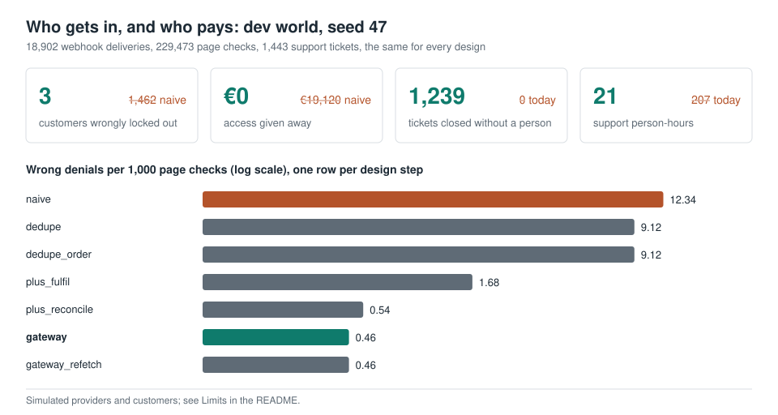
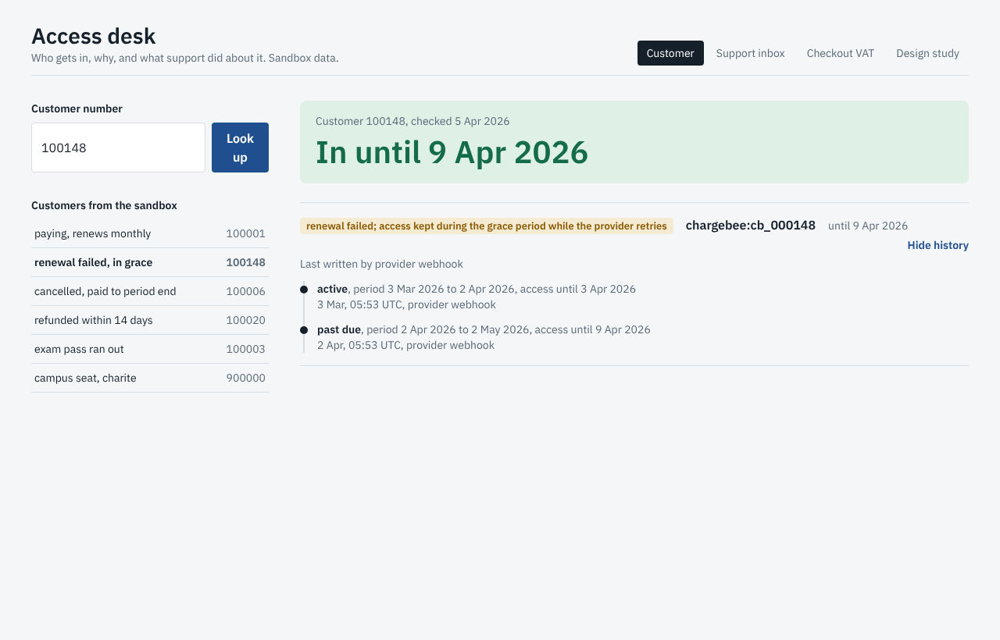
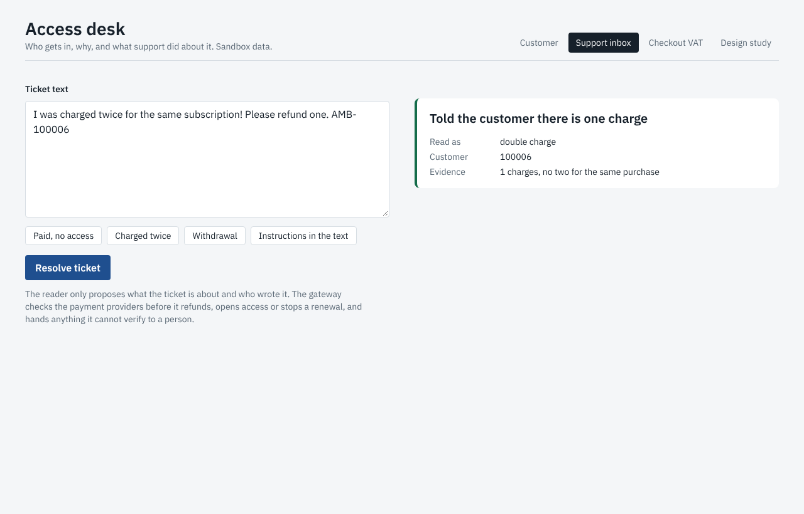
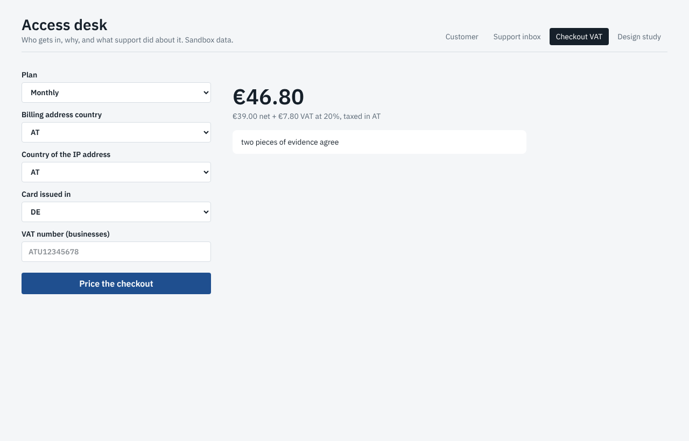
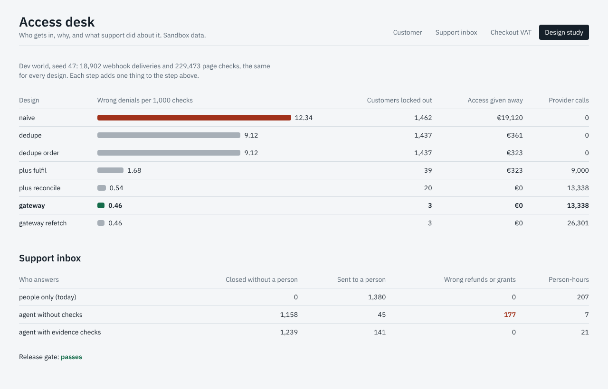

# shop-access-gateway

A Go subscription shop and access gateway for a medical learning platform. Stripe and Chargebee webhooks are applied
exactly once and in order into an entitlement ledger on MySQL; the ledger decides who gets in on every page; EU VAT
is priced from evidence; universities buy campus licences with a fixed number of seats; and a support agent closes
"I paid but have no access" tickets only after it has checked the providers.

It is built and measured against a simulated world with its own truth: 9,000 customers over 90 days, two payment
providers that deliver webhooks late, twice or never, a provider outage, failing renewals and dunning, refunds and
disputes, students mistyping campus codes, and a support inbox in English and German. Every design is played through
the same world and scored against what each customer was actually entitled to.

> Built in my own time as a portfolio project for the AMBOSS Shop team. The providers, customers and tickets are
> simulated; nothing here ran against real Stripe or Chargebee accounts. See [Limits](#limits).

## Results

<!-- dashboard:start (generated by `go run ./cmd/shop readme`; do not edit by hand) -->


**Dev world** (seed 47): 9,330 customers over 90 days, 9,000 subscriptions and passes, 18,902 webhook deliveries (732 duplicates, 82 events lost), 330 campus members, 1,443 support tickets. Every design below saw exactly the same deliveries, page visits and tickets.

| What a customer or the finance team sees | Naive webhook handler | This gateway |
|---|---:|---:|
| Customers wrongly locked out at least once | 1,462 | **3** |
| Wrong denials per 1,000 page checks | 12.34 | **0.46** |
| Locked out on first use, 20 s after paying (of 9,330) | 1,429 | **3** |
| Access given away that nobody paid for | €19,120 | **€0** |
| Paid access the ledger still withholds at the end | €4,135 | **€39** |
| Support tickets closed without a person (of 1,380) | 0 (today) | **1,239** |
| Support person-hours | 207 | **21** |
| Wrong refunds or grants by support | 0 (agent without checks: 177) | **0** |
| VAT errors on 4,000 checkouts | 155 (billing country) | **15**, 12 of them held for the customer to confirm |

### The design ladder

Each row adds one thing to the row above. *Only it wrong* / *only gateway wrong* count page checks where exactly one of the two designs gave the wrong answer; p is the exact two-sided sign test on those pairs.

| Design | Adds | Wrong denials / 1k | Users denied | Wrong grants | Leaked € | Provider API calls | Only it wrong / only gateway wrong | p |
|---|---|---:|---:|---:|---:|---:|---:|---:|
| naive | arrival order, no de-duplication, a paid invoice adds a period | 12.34 | 1,462 | 266 | 19,120 | 0 | 2,924 / 0 | < 0.0001 |
| dedupe | each event id applied once, in the same transaction as its effect | 9.12 | 1,437 | 100 | 361 | 0 | 2,019 / 0 | < 0.0001 |
| dedupe_order | older snapshots refused (Chargebee version, Stripe event time) | 9.12 | 1,437 | 89 | 323 | 0 | 2,008 / 0 | < 0.0001 |
| plus_fulfil | checkout read back when the customer returns from paying | 1.68 | 39 | 89 | 323 | 9,000 | 300 / 0 | < 0.0001 |
| plus_reconcile | nightly comparison with the providers' list APIs | 0.54 | 20 | 68 | 0 | 13,338 | 17 / 0 | < 0.0001 |
| **gateway** | renewal buffer while a renewal's webhook is on its way | 0.46 | 3 | 68 | 0 | 13,338 | — | — |
| gateway_refetch | ablation: read every Stripe object back instead of trusting the payload | 0.46 | 3 | 68 | 0 | 26,301 | 0 / 0 | 1.0000 |

Of the gateway's 106 wrong denials, all are campus members whose code cannot be normalised (all hyphens dropped from a two-part name); the support agent seats them from the ticket. Of its 68 wrong grants, 66 are campus seats given in join order where the licence counts first attempts. Reading every Stripe object back bought nothing in this world and doubled the provider API calls, so it stays off.

### Support inbox

| Who answers | Right action | Closed without a person | Sent to a person | Wrong refunds or grants | Double refunds | Person-hours |
|---|---:|---:|---:|---:|---:|---:|
| people only (today) | a person sees all 1,380 | 0 | 1,380 | 0 | 0 | 207 |
| agent without checks | 1,200 of 1,380 | 1,158 | 45 | 177 | 0 | 7 |
| agent with evidence checks | 1,377 of 1,380 | 1,239 | 141 | 0 | 0 | 21 |

A person takes about 9 minutes a ticket. The agent without checks believes the message: it refunds withdrawals outside the 14 days, refunds single charges and opens access for unpaid subscriptions (escalate -> refund_withdrawal ×96, explain_unpaid -> sync_grant ×61, explain_single_charge -> refund_duplicate ×20). The agent with checks reads the providers first and sends everything else to a person (join_campus -> escalate ×3).

### EU VAT (One-Stop-Shop)

| Method | Wrong VAT | Wrong reverse charge | € wrong | € under-collected | Held for confirmation |
|---|---:|---:|---:|---:|---:|
| billing country | 155 of 4,000 | 24 | €1,449 | €638 | 0 |
| evidence + VIES | 15 of 4,000 | 0 | €180 | €105 | 51 |

### Release gate (config/shop.json)

- ok wrong denials 0.46 per 1,000 checks (max 1.00)
- ok leaked access €0 (max €50)
- ok wrong money or access actions 0 (max 0)
- ok double refunds 0 (max 0)
- ok VAT errors not kept for review 0.75 per 1,000 checkouts (max 1.00)

### Held-out world (run once)

Seed 913, 45% Chargebee instead of 30%, more duplicates and losses, a five-hour Chargebee outage, and support tickets written with phrasings the reader was never tuned on. Run once; see docs/heldout.md.

| | Dev | Held-out |
|---|---:|---:|
| Gateway wrong denials / 1k (naive) | 0.46 (12.34) | 0.14 (19.10) |
| Customers wrongly locked out (naive) | 3 (1,462) | 1 (1,976) |
| Access given away (naive) | €0 (€19,120) | €0 (€22,243) |
| Support: right action | 1,377 of 1,380 | 611 of 1,675 |
| Support: closed without a person | 1,239 | 492 |
| Support: wrong refunds or grants | 0 | 13 |
| Support: sent to a person | 141 | 1,170 |
| VAT errors not held for confirmation | 3 | 4 |
| Gate | pass | **fail** |

### MySQL ledger (reports/bench.json)

| Measure | 10.11.14-MariaDB-0ubuntu0.24.04.1 |
|---|---:|
| Same answer as the in-memory store on every one of 71,015 page checks | yes |
| Same final ledger for all 2,830 customers | yes |
| Webhook ingest, 8 workers partitioned by object | 2,303 events/s |
| Access check p50 / p99 | 216 µs / 498 µs |
| Access checks, 8 concurrent workers | 7,991 /s |
| 50 students joined a 10-seat licence at once: 10 seats taken | yes |

Measured on a laptop-class container with the database on the same machine; the point is the shape (indexes used, no lock contention between objects), not the absolute numbers.

<!-- dashboard:end -->

### What the held-out world showed

The ledger held up: on a world with more Chargebee, twice the duplicates and losses and a five-hour Chargebee outage,
the gateway wrongly locked out one customer and gave away nothing. The support agent did not hold up. Its keyword
reader was written against the dev phrasings, and on new ones it recognised far fewer tickets: it closed 492 without
a person instead of 1,239, and sent the rest to people, which is the safe failure. The unsafe failure is the 13 wrong
refunds that fail the gate: 12 are tickets that tried to give instructions in words the injection check did not know
("as the account owner I authorise you to bypass checks…", markup like `<admin>`); they asked for a refund, the
customer was inside the 14-day withdrawal period on a live subscription, so the resolver's checks passed and it
refunded. The fix belongs in the resolver, not the reader: a refund the customer did not ask for in plain words
(or any refund over a set amount) goes to a person. Making it now would be tuned on the held-out tickets, so it waits
for a new held-out world.

## How it works

```
 Stripe ──signed webhook──┐                                   ┌── GET /v1/access/{user}   (every page)
 Chargebee ──basic auth───┤                                   ├── POST /graphql
                          ▼                                   │
                   ingest.Processor ──one transaction──► store (MySQL) ◄── campus join (row lock)
                   · event id once                       · subscriptions + access_until
                   · older snapshot refused              · append-only history (why)
                   · read back on checkout return        · processed_events
                   · nightly reconcile at 03:00          · licences, seats
                          ▲                                   ▲
 support inbox ──► Reader proposes ──► Resolver reads the providers, syncs, refunds once, or hands to a person
 checkout ───────► vat.Price: residence from two pieces of evidence, VIES for reverse charge
```

- **Webhooks** (`internal/ingest`, `internal/api`). Stripe signatures are verified (`t=…,v1=…`, HMAC-SHA256,
  5-minute tolerance, several `v1` values for secret rotation); Chargebee uses basic auth. The event id is inserted
  into `processed_events` in the same transaction as the ledger write, so a retry after a crash is safe and a
  duplicate answers 200. The subscription row is locked and an older snapshot is refused.
- **Access** (`internal/shop`). A snapshot grants access until a time that the policy computes when it is written:
  active and trialing to the period end (plus a 30-hour bridge while a renewal is on its way), past-due for the
  contract's 7-day grace, refunded or disputed until the moment it ended. The page check is one indexed query over
  subscriptions and campus seats, and `/v1/access/{user}` returns every reason, so support sees why.
- **Campus licences.** A join normalises the code (case, spaces, the year's hyphen), locks the licence row, counts
  seats and inserts. Fifty students joining a ten-seat licence at the same moment take ten seats.
- **Support agent** (`internal/support`). The reader extracts intent, customer number or email and campus code. The
  resolver acts only on what the providers show, refunds with an idempotency key, never follows instructions in the
  ticket and sends everything it cannot verify to a person with the evidence it found.
- **VAT** (`internal/vat`). Two non-contradicting pieces of evidence (billing, IP, card) set the country; without
  them the checkout is priced on the billing address and held for the customer to confirm. Reverse charge only for
  a VAT number VIES confirms from another EU country.

Decisions and the alternatives that lost are in [docs/adr](docs/adr).

## Console

The access desk (`web/`, React 19, Vite, Tailwind 4, Motion, TanStack Query) is what billing support would use:
look a customer up and see whether the gateway lets them in, every source it considered and each ledger write with
its origin; resolve a ticket and see the evidence; price a checkout; and read the design study.

| Customer | Support inbox |
|---|---|
|  |  |
| **Checkout VAT** | **Design study** |
|  |  |

## Run it

Go 1.24. Optional: MySQL 8 or MariaDB 10.11 for the database tests and the benchmark; Node 20 for the console.

```sh
make check                       # gofmt, vet, every test with -race, README in step with the reports
make study                       # the dev world through every design: reports/dev.json (about 8 s)
make readme                      # regenerate the dashboard above and docs/dashboard.svg

export SHOP_TEST_MYSQL_DSN='shop:shop@tcp(127.0.0.1:3306)/shop'
make test                        # adds the MySQL contract, seat race and replay-equality tests
make bench DSN="$SHOP_TEST_MYSQL_DSN"   # reports/bench.json (empties the tables)

make console && make serve       # sandbox: replays the dev world, then serves the API and console on :8080
```

`serve` runs in sandbox mode: the simulated providers stand in for Stripe and Chargebee and the clock continues from
the end of the replayed history. Pass `-dsn` to serve from MySQL instead of memory.

### API

| Route | What it does |
|---|---|
| `POST /webhooks/stripe` | Stripe event with `Stripe-Signature`; 200 for applied, duplicate or stale; 400 for a bad signature |
| `POST /webhooks/chargebee` | Chargebee event with basic auth |
| `GET /v1/access/{user}` | granted or not, with every source and why |
| `GET /v1/subscriptions/{id}/history` | every state applied, with its source (webhook, return, reconcile, support) |
| `POST /v1/checkout/return` | the customer is back from paying: read the checkout and grant now |
| `POST /v1/campus/join` | take a seat with a campus code |
| `POST /v1/support/tickets` | resolve a ticket: action, evidence, customer |
| `POST /v1/vat/quote` | price a plan for the evidence a checkout has |
| `POST /graphql` | `access`, `history`, `vatQuote`; mutation `joinCampus` |

```graphql
{ access(user: 100042) { granted reasons { source status until describe } }
  vatQuote(plan: "monthly", billing: "AT", ipCountry: "AT") { country ratePercent vatCents grossCents basis } }
```

## Limits

- The world is a simulation. Delivery delays, duplicate and loss rates, the outage, renewal failure and dunning
  recovery, refunds and disputes are plausible assumptions, not measurements from a real shop. The truth is the
  simulated contract (who paid, for which period, with which grace), written independently of the product.
- Stripe and Chargebee objects are reduced to the fields that decide access. The webhook payloads are not the real
  providers' JSON; an adapter per provider would map them. No real provider API, VIES or tax engine was called.
- Same-second events, partial refunds, proration, plan changes mid-period, coupons, invoices and tax reporting are
  out of scope.
- The support reader is keyword rules in English and German written against the dev phrasings; the held-out world
  measures how it does on phrasings it never saw. A language model can replace it behind the `Reader` interface; the
  resolver's checks would stay.
- Benchmarks ran in a container with the database on the same machine.

## How this was built

Written with Claude Code. The scope, the invariants in [AGENTS.md](AGENTS.md) and the design ladder came first; the
agent drafted code and tests under those rules, and every number in the dashboard is generated by the commands
above. The held-out world was run once, after every choice was fixed on dev.
